# 👾 Graphlings

> 🤖 **KI-Hinweis:** Dieses Projekt ist mit KI-Unterstützung entstanden. Code, Texte und die Monster-Grafiken wurden zusammen mit Claude Code (Anthropic) geschrieben und vom Autor geprüft. Der Chat im Programm läuft gegen ein kleines lokales Sprachmodell (Qwen2.5 1.5B). Seine Antworten können falsch oder unvollständig sein, nichts davon verlässt deinen Rechner.

Agents und Graphen zum Zusammenstecken. In der Mitte baust du einen Graphen aus Karten: kleine Graphlings, die du mit Kanten von Puzzle-Nase zu Puzzle-Kerbe verbindest. Auf jeder Karte sitzt ihr Monster, in jeder Karte steckt ein Puzzle mit ihren Einstellungen. Mit **🐍 Code zeigen** klappst du den lesbaren Python-Code daneben auf, er entsteht live mit. Mit **▶️ Graph starten** unten rechts läuft der Graph sofort gegen ein eingebautes lokales Modell. Dabei leuchtet die Karte, die gerade arbeitet, ihr Monster denkt nach, und der Notizzettel wandert über die Kanten.



## Für Tester 🚀

1. Die neueste `Graphlings-win-x64.zip` von der [Release-Seite](https://github.com/LemurDaniel/Graphlings/releases/latest) herunterladen (ca. 1,1 GB, das Modell ist dabei) und entpacken.
2. `Graphlings/Graphlings.exe` starten. Windows warnt eventuell („Unbekannter Herausgeber“): *Weitere Informationen → Trotzdem ausführen*.
3. Unten rechts **▶️ Graph starten** klicken. Im Fenster, das aufgeht, warten, bis **🟢 Modell bereit** steht, dann lostippen.

Nichts zu installieren: Python, llama-server und das Modell (Qwen2.5 1.5B) stecken im Ordner. Alles läuft lokal, ohne Internet.

Tipps fürs Zuschauen:

- **🐢 Tempo-Regler** unten im Chat: eine Pause vor jedem Schritt, damit du siehst, wer gerade arbeitet und wohin der Notizzettel wandert.
- **🌐 English / Deutsch** oben rechts schaltet die Sprache um. Beispiele und Standard-Prompts folgen der Sprache, das Modell antwortet dann auch so. Gespeicherte Graphen bleiben, wie sie sind.
- **🌙 Dunkel** schaltet das Thema, **🧹 Leeren** räumt die Fläche. Karten löschst du, indem du sie in den 🗑️ Mülleimer unten links ziehst, Strg+Z holt sie zurück.
- Klick auf ein Monster: es macht ein Kunststück. Die Augen folgen deiner Maus.

## Karten, Ressourcen und Puzzleteile 🧩

Zwei Arten von Linien: **durchgezogen** (Nase → Kerbe) heißt „danach läuft …“ und wird ein Eintrag in `EDGES`. **Gepunktet** (Steckplatz unten → Knubbel oben) heißt „benutzt …“ und wird ein Argument im Code, z. B. `ask_model(QWEN_MODEL, …)`.

| Schritt (Karte) | Monster | Wird im Code |
| --- | --- | --- |
| 🟢 START / 🏁 END | | Ein- und Ausgang einer Runde: `EDGES[START]`, `END` beendet `run_graph()`. END zeigt, wohin der Notizzettel geht: 💾 ins Gedächtnis, 🗑️ in den Müll oder 📋 als Ergebnis einer Aufgabe |
| 🤖 Agent | blauer Zyklop mit Antenne | Knoten-Funktion: Rolle (System-Prompt) plus Verlauf an sein Modell, Antwort anhängen |
| 🗜️ Zusammenfasser | lila, mit Brille und Papierstapel | Compacting: Zusammenfassung plus die letzten N Nachrichten |
| 🔧 Werkstatt | orange, mit Helm und Schraubenschlüssel | Werkzeugkasten wie ein MCP-Server: `list_tools()` für den Agenten, als Knoten `call_tool()` für die `tool_calls` |
| 🔀 Weiche | pink, drei Augen, Pfeil-Hörner | Routing-Funktion, steht in `EDGES` statt eines Namens: „ja“/„nein“ oder ein Weg pro Option |

| Ressource | Benutzt von | Wird im Code |
| --- | --- | --- |
| 🧠 Modell | Agent, Zusammenfasser, Weiche, Hilfsagent | `QWEN_MODEL = {"model": …, "temperature": …}`, zustandslos. Mehrere Agenten teilen ein Modell oder haben eigene, z. B. „kreativ“ (0.9) und „genau“ (0.1) |
| 🗂️ Notizzettel (State) | START | `new_state()`: ein `dict` mit `messages` und den Feldern der Karte. Lebt eine Runde lang und wandert von Karte zu Karte |
| 💾 Gedächtnis | START | `MEMORY[thread_id]`: ein Fach pro Gespräch, in das der Notizzettel nach der Runde kommt. Ohne Gedächtnis wird er bei END verworfen |
| 🔧 Werkzeug | Werkstatt | Python-Funktion plus Beschreibung in `TOOL_SCHEMAS` |
| 🤖 Hilfsagent (grün, Propellermütze) | Werkstatt | Ein Agent als Werkzeug („agents as tools“): `dichter(task)` ruft `ask_model()` mit eigenem Prompt, eigenem Modell und nur der Aufgabe auf einem frischen Zettel und gibt nur die Antwort zurück. Das Gespräch des Chefs sieht er nie |
| 🔌 Werkstatt (MCP) | Agent | `tools=list_tools(WERKSTATT_TOOLS)`: das Modell bekommt die Werkzeugliste |

| Puzzleteil | Steckt in | Wird im Code |
| --- | --- | --- |
| 📏 mehr als N Nachrichten | Weiche | Bedingung der Routing-Funktion |
| 📝 enthält Wort | Weiche | Prüft die letzte Antwort, z. B. auf „OK“ vom Kritiker |
| 🔧 will Werkzeug? | Weiche | Hat die letzte Antwort `tool_calls`? Dann zur Werkstatt |
| 🧠 Modell entscheidet + Wege | Weiche | Das Modell wählt einen Weg, ein Ausgang pro Weg |
| 🔤 Feld | Notizzettel | weiterer Schlüssel in `new_state()` |
| ⚙️ Einstellungen aus .env | Bauplan | `load_env_file()`, `os.getenv()` und Prüfungen |

Im Chat endet eine Runde bei END, danach wartet `main()` auf die nächste Frage und startet den Graphen wieder bei START. Den **Bauplan** öffnest du mit ⟨ am rechten Rand der Arbeitsfläche, wenn keine Karte ausgewählt ist. Dort stellst du **💬 Chat** (Frage um Frage) oder **📋 Aufgabe** (einmal durchlaufen, am Ende siehst du den Notizzettel) ein und wie viele Schritte eine Runde höchstens machen darf. Welche Agenten ihre Antwort zeigen, entscheidet das Häkchen **📣 Antwort zeigen** in der Karte. Prompts bearbeitest du in einem mehrzeiligen Textfeld, das mit dem Text wächst.

**🔌 Werkstatt und MCP:** Die Werkzeuge hängen an der Werkstatt, der Agent steckt sich mit einer gepunkteten Linie ein. Das ist die Idee vom [Model Context Protocol](https://modelcontextprotocol.io): `list_tools()` entspricht `tools/list`, `call_tool()` entspricht `tools/call`. Bei echtem MCP läuft die Werkstatt als eigenes Programm, hier steht sie in derselben Datei.

**🤖 Hilfsagenten und Subagents:** Ein Hilfsagent hängt in der Werkstatt neben den Werkzeugen. Für das Modell des Chefs ist er einfach ein Werkzeug mit einer Aufgabe als Argument. Er arbeitet auf einem eigenen, leeren Notizzettel und gibt nur sein Ergebnis zurück, genau wie Subagents in Claude Code oder „agents as tools“ im OpenAI Agents SDK. Die Weiche mit Spezialisten ist dagegen ein *Handoff*: Die Frage wird weitergereicht, der Spezialist antwortet selbst.

**🧩 Beispiel laden** zeigt je ein Muster:

| Beispiel | Muster |
| --- | --- |
| 💬 Chat mit Zusammenfassung | START → chat → Weiche „zu_lang“ → zusammenfassen oder END, wie `chat.py` (Homelabs-KI) |
| 🔀 Schlaue Weiche + Spezialisten | Das Modell entscheidet, ob der Techniker oder der Plauderer antwortet (Handoff) |
| 🔧 Werkzeug-Agent | Agent-Schleife: helfer → will Werkzeug? → Werkstatt (Rechner, Uhr, Würfel) → zurück zu helfer |
| 🔁 Reflexion (Aufgabe) | Schreiber und Kritiker wechseln sich ab, bis der Kritiker „OK“ sagt |
| 👔 Chef mit Hilfsagenten | chef → will Hilfe? → Team mit dichter (kreatives Modell) und uebersetzer (genaues Modell) → zurück zum chef |

> 💡 Das kleine Modell (1,5B) befolgt Werkzeug-Regeln zuverlässiger auf Englisch. Gemessen (9 Fälle × 4 Läufe, Werkzeug- und Hilfsagenten-Beispiel): englische Regeln 36 von 36, dieselben Regeln auf Deutsch 29 von 36. Auf Deutsch würfelt der Helfer nicht und der Chef lehnt „schreib ein Gedicht“ ab, sogar auf Englisch. Deshalb sind die Regeln von helfer und chef englisch, nennen aber deutsche Auslöser („Gedicht“, „übersetzen“). Die Antwort kommt in der Sprache der Oberfläche. Du kannst den Prompt in der Karte jederzeit auf Deutsch umschreiben und selbst vergleichen.

**💾 chat.py speichern** exportiert den Code. Er läuft mit jedem Python 3.11+ ohne `pip install`, solange ein OpenAI-kompatibler Server unter `http://127.0.0.1:8081/v1` läuft (oder `LLM_BASE_URL` in `.env`).

## Entwickeln 🛠️

Voraussetzung: [uv](https://docs.astral.sh/uv/) (`winget install astral-sh.uv`) und für die Tests Node 20+. uv bringt Python und pywebview mit.

```powershell
./build.ps1 -Task Runtime                                     # llama-server + Modell nach runtime/
uv run --with-requirements app/requirements.txt app/main.py   # App aus dem Quellcode starten
python app/dev_server.py                                      # Seite + Chat im Browser unter http://127.0.0.1:8777
node tests/test.generator.mjs                                 # alle Beispiele erzeugen und prüfen, Deutsch und Englisch
python tests/test.model.py                                    # Beispiele gegen das echte Modell, prüft den Weg durch den Graphen
./build.ps1                                                   # build/Graphlings-win-x64.zip bauen
```

Der Dev-Server braucht nur die Standardbibliothek und `runtime/`. Er liefert die Seite ohne Cache aus und bietet dieselbe Schnittstelle wie die App unter `/api/*`, Antworten streamen als Server-Sent Events. Nur die Oberfläche ohne Chat: `web/` mit einem beliebigen statischen Webserver öffnen.

Release: Ein Tag wie `v0.2.0` pushen, dann baut [die Pipeline](.github/workflows/release.yaml) auf Windows die Zip, lässt den Generator-Test und den Self-Test laufen und legt das GitHub-Release mit der Zip als Download an. Ohne Tag (manuell gestartet) baut sie nur und hebt die Zip eine Woche als Artefakt auf.

Build prüfen ohne Fenster: `build/dist/Graphlings/Graphlings.exe --self-test <chat.py>` schreibt das Ergebnis nach `%LOCALAPPDATA%/Graphlings/self-test.txt`.

## Aufbau 📁

| Pfad | Inhalt |
| --- | --- |
| `app/` | Python: Fenster (pywebview), Dev-Server für den Browser, Runner für den erzeugten Code, Modellserver |
| `web/` | Die Seite: eigener Graph-Editor, Karten und Puzzleteile, Monster, Texte in Deutsch und Englisch, Python-Generator, Chat |
| `tests/` | `test.generator.mjs`: erzeugt und prüft alle Beispiele in beiden Sprachen mit Node. `test.model.py`: lässt sie gegen das echte Modell laufen und prüft den Weg |
| `build.ps1` | Lädt die Runtime, baut die Exe und das Zip |
| `.github/` | Release-Pipeline (baut und veröffentlicht bei einem `v*`-Tag) und die Release-Notizen |
| `docs/`, `tools/` | Das Teaser-Bild der README und `make.teaser.mjs`, das es aus den echten Monster-Grafiken erzeugt |
| `THIRD_PARTY_LICENSES.md` | Mitgelieferte Komponenten und ihre Lizenzen |
